# ELE304 Lab 3 – FFT on a dual-core STM32H755

NUCLEO-H755ZI-Q · CM4 samples the ADC and drives the DAC · CM7 moves each block to DTCM and runs a 1024-point RFFT · FreeRTOS on both cores.

**Code:** [`ele_304_lab4/`](ele_304_lab4) (STM32CubeIDE dual-core project) · **Experiment switches:** [`ele_304_lab4/Ipc_common/Inc/lab3modify.h`](ele_304_lab4/Ipc_common/Inc/lab3modify.h) · **Timing analysis script:** [`tools/la_stats.py`](tools/la_stats.py)

**Result in one line:** with polling, the CM7's 1 ms RTOS tick limits the system to about **1.85 MS/s**. With HSEM notification the software keeps up with the ADC's own maximum of **4.0 MS/s** (0 dropped blocks), so the **ADC hardware** is the final limit.

---

## Contents
1. [Lab questions](#1-lab-questions)
2. [System overview and data flow](#2-system-overview-and-data-flow)
3. [Build switches and debug pins](#3-build-switches-and-debug-pins)
4. [Task 3a – Does the RFFT work?](#4-task-3a--does-the-rfft-work)
5. [Task 3b – How long does each part take?](#5-task-3b--how-long-does-each-part-take)
6. [Task 3c/3d – Maximum sample rate and what limits it](#6-task-3c3d--maximum-sample-rate-and-what-limits-it)
7. [How each configuration failed](#7-how-each-configuration-failed)
8. [Conclusions](#8-conclusions)
9. [Key learnings](#9-key-learnings)
10. [Measurement method and caveats](#10-measurement-method-and-caveats)
11. [Repository layout](#11-repository-layout)

---

## 1. Lab questions

| Task | Question | Answered in |
|---|---|---|
| 1a | DAC thread giving a 1–2 kHz square and sine wave | DAC: 100-sample table at 100 kHz (TIM2) → **1 kHz** |
| 1b | ADC sampling at 100 kHz | TIM3 PSC 199 / ARR 9 → 100 kHz (measured 100.65 kHz) |
| 1c | Circular buffer of 2048 samples | DMA circular, 2 × 1024 halves |
| 1d | CM7 thread starts/stops the ADC and selects the waveform | CM7 control thread → IPC command → CM4 |
| 2a | Transfer ADC samples to DTCM on CM7 | CPU copy or MDMA, SRAM4 → DTCM |
| 2b | RFFT, FFTLen 1024, on samples in DTCM | `arm_rfft_fast_f32`, buffers in DTCM |
| 2c | Print only the latest RFFT when the ADC is stopped | printed once after STOP |
| 3a | Does the RFFT work? Explain the results | [Section 4](#4-task-3a--does-the-rfft-work) |
| 3b | Logic analyser: how long do the parts take? | [Section 5](#5-task-3b--how-long-does-each-part-take) |
| 3c | How fast can the ADC sample with HW and SW keeping up? | [Section 6](#6-task-3c3d--maximum-sample-rate-and-what-limits-it) |
| 3d | Which part limits the sample rate? | [Sections 6–7](#7-how-each-configuration-failed) |

---

## 2. System overview and data flow

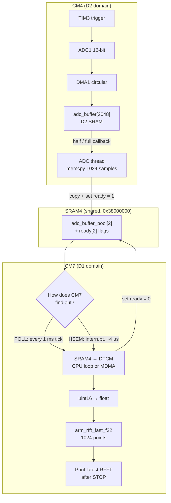

**The rule that causes overruns.** Each SRAM4 slot is reused every 2 × 1024 / fs. When CM4 wants to write a slot whose `ready` flag is still 1 (CM7 has not taken it yet), CM4 **drops** that block and counts an **overrun**. It never overwrites a block CM7 may be reading, so a block can never be half old, half new.

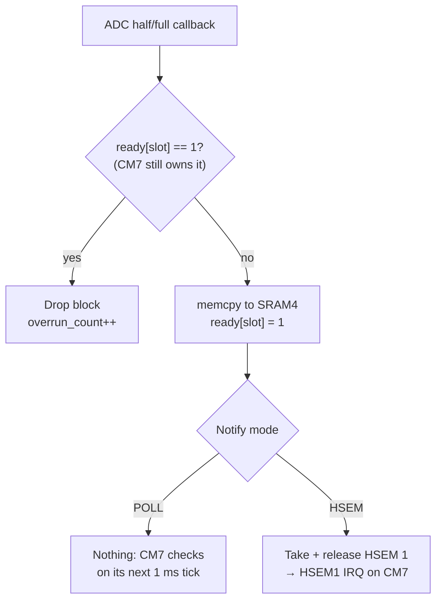

### Hardware and live demo

| Board setup | Demo run (click to open the video, 1 min 52 s) |
|---|---|
| 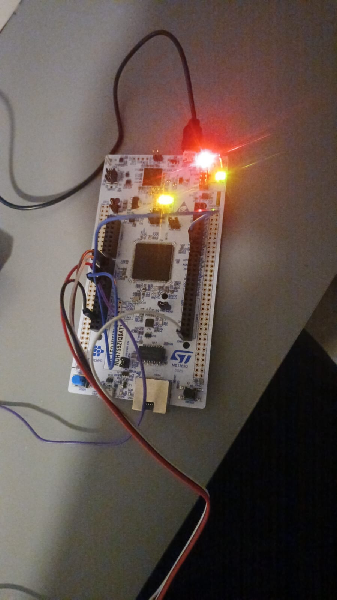 | <a href="docs/media/demo_run.mp4">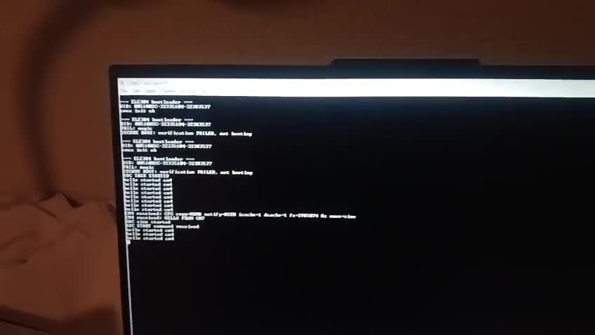</a> |

NUCLEO-H755ZI-Q powered over the ST-LINK USB. The DAC output is wired back to the ADC input, and the debug pins D0–D4 go to the logic analyser. The video shows a run of the HSEM build (`CFG copy=MDMA notify=HSEM icache=1 dcache=1`) on the UART terminal. Video file: [`docs/media/demo_run.mp4`](docs/media/demo_run.mp4).

---

## 3. Build switches and debug pins

All experiments use one shared header, [`Ipc_common/Inc/lab3modify.h`](ele_304_lab4/Ipc_common/Inc/lab3modify.h). Change one line, rebuild **both** cores. The first UART line (`CFG copy=… notify=… icache=… dcache=… fs=…`) confirms the build.

| Run | Copy | Notify | I-cache | D-cache | Isolates |
|---|---|---|---|---|---|
| 0 | CPU | POLL | off | off | baseline |
| 1 | CPU | POLL | on | off | I-cache |
| 2a | MDMA | POLL | off | off | MDMA alone |
| 2b | MDMA | POLL | on | off | MDMA with I-cache |
| 3 | MDMA | POLL | on | on | D-cache |
| 4 | MDMA | HSEM | on | on | HSEM instead of polling |

Sample rate: fs = 200 MHz / ((PSC + 1)(ARR + 1)). With PSC = 0, fs = 200 MHz / (ARR + 1).

| Ch | Pin | Core | High while | Measures |
|---|---|---|---|---|
| D0 | PB1 | CM4 | memcpy of a half-buffer to SRAM4 | CM4 copy time |
| D1 | PA3 | CM4 | first half filled (low = second half) | real fs: high time = 1024 / fs |
| D2 | PD0 | CM7 | `arm_rfft_fast_f32` | RFFT time |
| D3 | PC0 | CM7 | SRAM4 → DTCM transfer | transfer time |
| D4 | PE0 | CM7 | uint16 → float (MDMA mode only) | conversion time |

**CM7 reaction latency** = D0 falling edge (CM4 finished) → next D3 rising edge (CM7 starts).

---

## 4. Task 3a – Does the RFFT work?

**Yes.** At fs = 100 kHz the bin width is 100 000 / 1024 = **97.66 Hz**, so 1 kHz falls at bin 10.24. Both waveforms peak at bin 10, and the magnitudes match the theory to within a few percent.

### Sine, 1 kHz

| Bin | Frequency | Predicted | Measured |
|---|---|---|---|
| 0 (DC) | 0 Hz | ≈ 33.5 M | 33 842 292 |
| 9 | 879 Hz | ≈ 2.9 M | 2 788 595 |
| **10 (peak)** | **977 Hz** | **≈ 15 M** | **15 095 863** |
| 11 | 1 074 Hz | ≈ 4.7 M | 4 960 949 |

### Square, 1 kHz

| Component | Bin | Predicted | Measured |
|---|---|---|---|
| Fundamental 1 kHz | 10 | 4/π × sine ≈ 19.2 M | 19 118 130 |
| 3rd harmonic 3 kHz | 31 (30.72) | ≈ 6.15 M | 5 958 033 |
| 5th harmonic 5 kHz | 51 (51.2) | ≈ 3.94 M | 3 819 909 |
| Even harmonics 2, 4 kHz | 20, 41 | ≈ 0 | 688 787 / 211 892 (leakage floor) |

UART log of the RFFT printout (run 0, 100 kHz, sine):

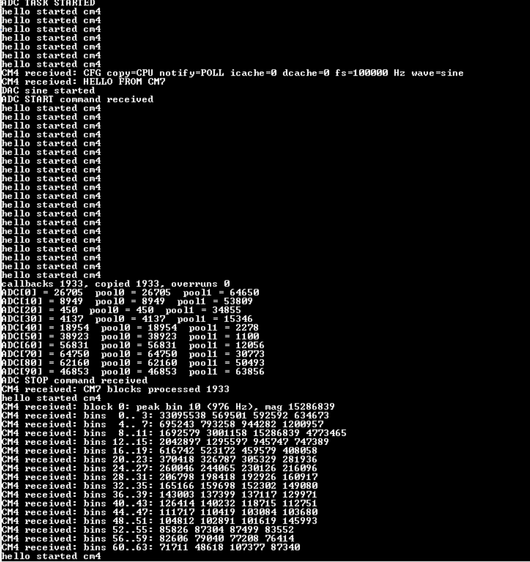

**Explanation**
- **Peak position.** 1 kHz / 97.66 Hz = bin 10.24 → peak in bin 10.
- **Leakage.** 1024 samples hold 10.24 periods, not a whole number, so energy spreads to neighbouring bins. Bin 11 (closer to 10.24) is larger than bin 9.
- **Amplitude.** |X| ≈ A · N/2 × scalloping loss (0.91 at 0.24 bin offset) → A ≈ 32 400 counts ≈ 1.63 V: the DAC's full 0–3.3 V swing.
- **DC.** 33.84 M / 1024 ≈ 33 050 counts ≈ 1.66 V = the sine's midpoint.
- **Square wave.** Only odd harmonics, falling as 1/n (Fourier series 4A/π · [sin ωt + ⅓ sin 3ωt + ⅕ sin 5ωt …]). Square / sine fundamental = 1.266, theory 4/π = 1.273.
- **At high fs** the bin width grows (fs / 1024), so a 1 kHz tone lands in bin 1. Higher fs gives more bandwidth, not better resolution.

---

## 5. Task 3b – How long does each part take?

Medians from Logic 2 CSV exports (thousands of blocks per run). Durations depend on the block size (1024), not on fs.

| Run | Config | D0 CM4 copy | D3 transfer | D4 convert | D2 RFFT | **CM7 work** | **Latency D0↓ → D3↑** |
|---|---|---|---|---|---|---|---|
| 0 | CPU, poll, no cache | 82.3 µs | 196.4 µs | — | 317.3 µs | **514 µs** | 0.2 – 994 µs (median 330) |
| 1 | CPU, poll, I$ | 82.7 µs | 183.4 µs | — | 178.0 µs | **362 µs** | 0.3 – 995 µs (median 332) |
| 2a | MDMA, poll, no cache | 83.2 µs | 17.8 µs | 183.6 µs | 342.2 µs | **544 µs** | 0.04 – 994 µs (median 328) |
| 2b | MDMA, poll, I$ | 82.5 µs | 17.4 µs | 184.3 µs | 178.2 µs | **380 µs** | 0 – 995 µs (median 326) |
| 3 | MDMA, poll, I$ + D$ | 82.6 µs | 18.2 µs | 56.1 µs | 90.2 µs | **165 µs** | 0 – 994 µs (median 389) |
| 4 | MDMA, **HSEM**, I$ + D$ | 85.8 µs | 18.2 µs | 53.6 µs | 90.5 µs | **163 µs** | **3.8 – 15 µs (median 4.2)** |

In CPU mode the float conversion happens inside the D3 copy loop, so D4 is empty.

### Logic analyser captures

**Run 0 at 100 kHz** (CPU copy, polling, no caches):

| Channel | Capture |
|---|---|
| D0 CM4 copy (83.7 µs every 10.18 ms) | 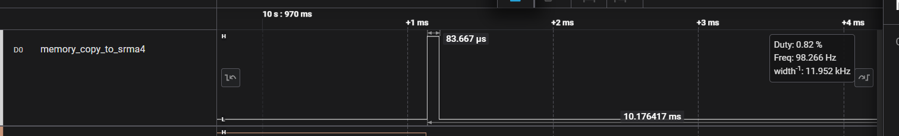 |
| D1 half/full (10.17 ms → fs = 100.65 kHz) | 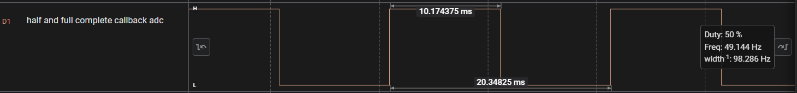 |
| D2 RFFT (317 µs) | 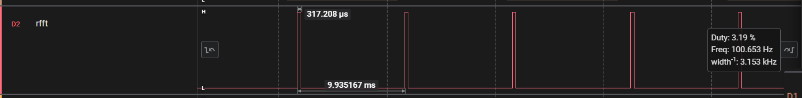 |
| D3 CPU copy to DTCM (196 µs) | 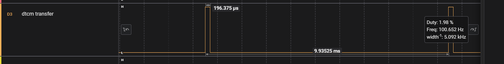 |

**Run 4** (MDMA, HSEM, I + D-cache), TIM3 set to 4.167 MHz, real rate 2.52 MS/s (see Section 7):

| Channel | Capture |
|---|---|
| D0 CM4 copy (82 µs) | 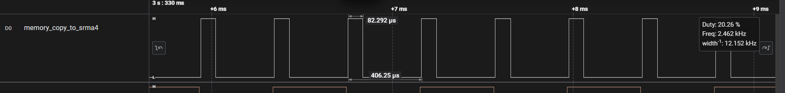 |
| D1 half/full (407.7 µs) | 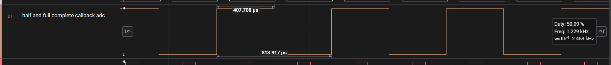 |
| D3 MDMA (18 µs) | 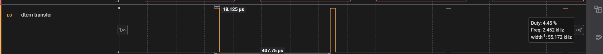 |
| D4 uint16 → float (54 µs) | 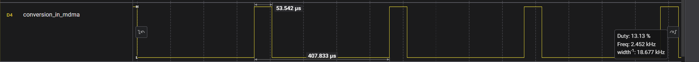 |
| D2 RFFT (91 µs) | 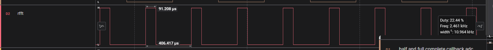 |

**What changed what**

| Change | Effect | Why |
|---|---|---|
| I-cache on (0 → 1) | RFFT −44 % | The CMSIS-DSP FFT is a large optimised library executed from flash; the I-cache removes flash wait states. |
| I-cache on (0 → 1) | Copy loop only −7 % | Our loop is compiled at `-O0`; its time is set by stack loads/stores, not by instruction fetch. |
| MDMA (0 → 2a) | Data move 196 → 18 µs, but conversion stays 184 µs | Moving 2 KB was never the expensive part; converting 1024 values in a `-O0` loop is. |
| D-cache on (2b → 3) | Convert −70 %, RFFT −49 %, work −57 % | Stack accesses (task stack in AXI SRAM) and the FFT's twiddle tables in flash become cached. |
| HSEM (3 → 4) | Latency 0–994 µs → about 4 µs (about 240× lower median) | CM7 wakes when a block is ready, instead of on the next 1 ms tick. |

---

## 6. Task 3c/3d – Maximum sample rate and what limits it

"Limit" = highest rate with 0 overruns over about 20 s (about 20 000–77 000 blocks).

| Run | Config | **Highest fs, 0 overruns** | First failing fs | Overruns there | Limited by |
|---|---|---|---|---|---|
| 0 | CPU, poll, no cache | **1.006 MS/s** (1.000 MHz set) | 1.053 MHz | 553 / 20 343 (2.7 %) | throughput: two blocks take more than one tick |
| 2a | MDMA, poll, no cache | **1.027 MS/s** (1.020 MHz set) | 1.053 MHz | 553 / 20 363 (2.7 %) | throughput: two blocks take more than one tick |
| 1 | CPU, poll, I$ | **1.513 MS/s** (1.504 MHz set) | 1.653 MHz | 727 / 31 960 (2.3 %) | deadline: tick latency + 184 µs slot release |
| 2b | MDMA, poll, I$ | **1.835 MHz set** | 1.869 MHz | 234 / 36 141 (0.65 %) | deadline: tick latency |
| 3 | MDMA, poll, I$ + D$ | **1.846 MS/s** (1.835 MHz set) | 1.869 MHz | 205 / 36 141 (0.57 %) | deadline: tick latency (CPU about 70 % idle) |
| **4** | **MDMA, HSEM, I$ + D$** | **4.024 MS/s** (4.000 MHz set) | none in software | 0 / 77 339 | **ADC hardware** |

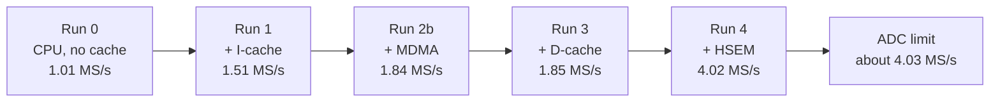

**Answer to 3c:** the ADC can sample at **4.0 MS/s** (16-bit) while the hardware and software keep up: at 4.02 MS/s CM4 uses about 34 % of each block period and CM7 about 64 %, with 0 dropped blocks.

**Answer to 3d:**
- With **polling**, the **1 ms RTOS tick** is the limiting factor: it sets both how long a block waits (up to about 1 ms) and how many blocks CM7 can handle per tick.
- With **HSEM**, the **ADC conversion time** (about 250 ns per 16-bit sample) is the limit. The next limits would be CM7 (about 6 MS/s at 163 µs per block) and CM4 (about 12 MS/s at 86 µs per block).

---

## 7. How each configuration failed

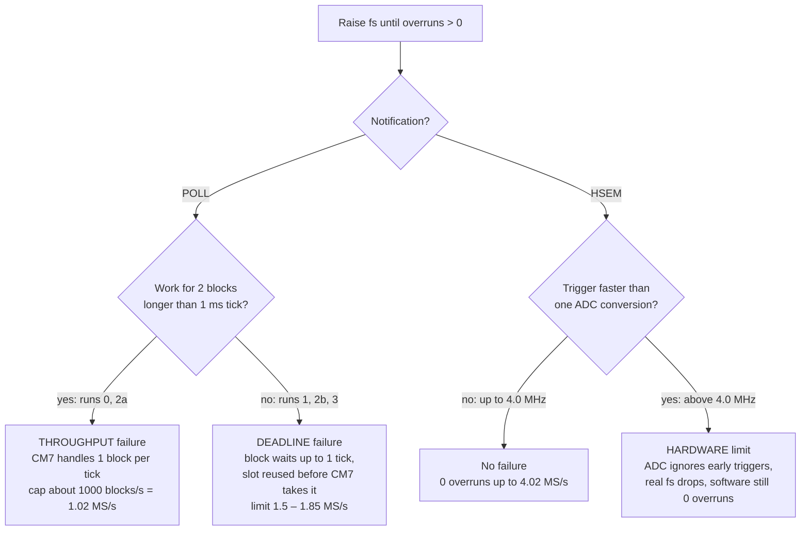

### Failure 1 – Throughput (runs 0 and 2a, about 1.02 MS/s)

- The CM7 thread wakes on a 1 ms tick, processes the ready blocks, then sleeps until the next tick.
- Two blocks take 2 × 514 µs = 1028 µs (run 0), just over one tick. CM7 settles into "2 blocks, then sleep a whole tick", i.e. **1 block per ms**.
- Evidence: in every overloaded polling run CM7 processed almost exactly 1 000 blocks/s (19 800 blocks in 19.8 s at 1.2, 1.7 and 4.0 MS/s). At 1.2 MS/s the gaps between transfers were 500–599 µs (9 900 times) and 1 400–1 499 µs (9 899 times): pairs of blocks, then a tick of sleep.
- Cap: 1 000 blocks/s × 1 024 = 1.02 MS/s. First failure at 1.053 MHz with 2.7 % overruns, as predicted.

| Run 0 at 1.0 MS/s: 0 overruns | Run 0 at 1.71 MS/s: 13 252 overruns |
|---|---|
| 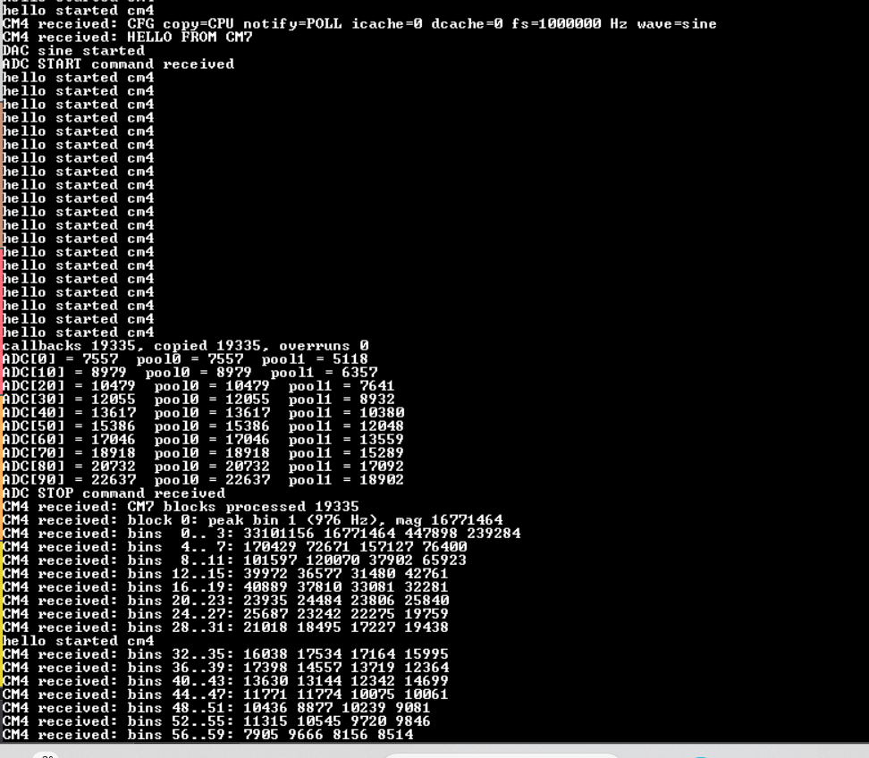 | 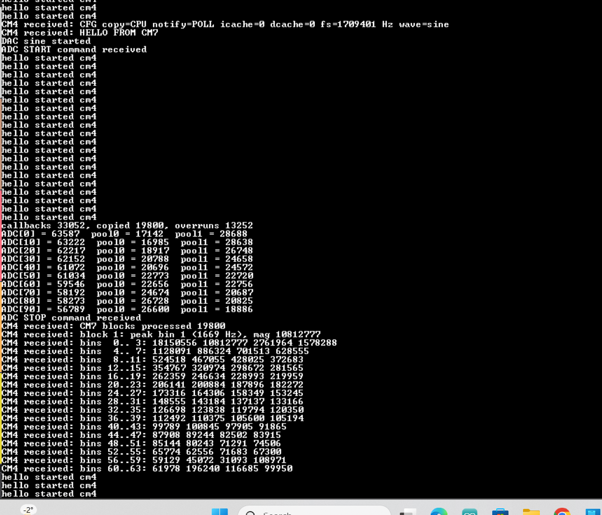 |

### Failure 2 – Deadline (runs 1, 2b and 3, 1.5–1.85 MS/s)

- Work per pair now fits in one tick, so throughput is no longer the limit.
- But a block can still wait up to one tick (latency up to 995 µs) before CM7 looks at it. CM4 reuses the slot every 2 × 1024 / fs. When latency + slot release exceeds that, the next block is dropped.
- Run 1 releases the slot after the 184 µs CPU copy → limit 1.51 MS/s. Runs 2b and 3 release it after the 18 µs MDMA → limit 1.85 MS/s.
- Occasionally CM7 woke just before a block arrived and slept a whole extra tick (208 gaps of 1.2 ms at 1.66 MS/s in run 1), which is why limits sit a little below the simple estimate.
- **Run 3 shows the key point:** the D-cache made CM7 2.3× faster (380 → 165 µs), but the limit did not move (1.846 MS/s), because the CPU just waited longer for the tick.

### After HSEM – no software failure; the ADC is the limit

- With HSEM, CM7 reacts in about 4 µs. **No overruns occurred at any tested rate** (1.869, 1.942, 1.980, 2.020, 2.985, 3.774 and 4.000 MHz).
- The same ceiling appeared in run 0 when TIM3 was set absurdly fast (PSC 1, ARR 0): the ADC still converted at only 4.03 MS/s (77 343 callbacks in about 19.8 s), with the polling CM7 able to take just 1 000 blocks/s:

  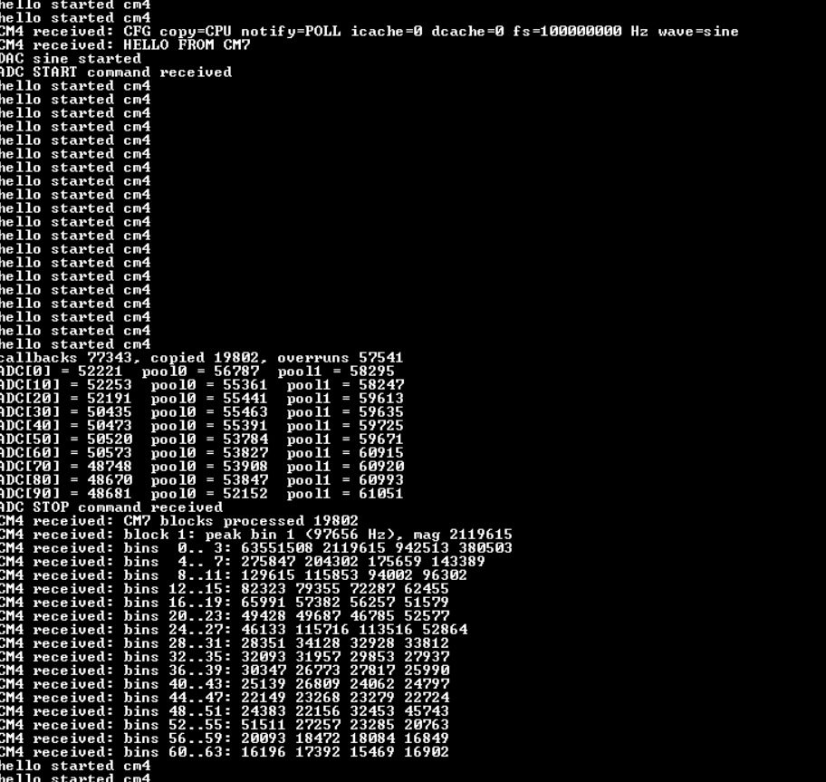

- The ADC needs about 250 ns per 16-bit conversion (about 40 MHz ADC clock / 10 cycles), so it converts at most about 4.03 MS/s.
- Above that, triggers that arrive while a conversion is still running are **ignored**. The real rate is the trigger rate divided by a whole number, so it **drops** instead of rising:

| Set fs (TIM3) | Trigger period | Real fs (measured) | Overruns |
|---|---|---|---|
| 4.000 MHz (ARR 49) | 250 ns | **4.024 MS/s** – every trigger converted | 0 |
| 4.167 MHz (ARR 47) | 240 ns | **2.516 MS/s** (D1 = 407.0 µs, σ 0.9 µs) | 0 |
| 4.878 MHz (ARR 40) | 205 ns | **2.44 MS/s** – every second trigger | 0 |

```
trigger every 205 ns:   |         |         |         |         |
ADC (250 ns each):      [ convert  ]        [ convert  ]        [ ...
                        accepted  ignored   accepted  ignored   accepted
```

Above 4.0 MHz nothing crashes and no data is lost, but the real rate is not what was set, so `fs=` in the CFG line and the Hz label in the FFT printout are wrong. **The usable maximum is therefore 4.0 MS/s (ARR ≥ 49).**

---

## 8. Conclusions

1. **The RFFT works.** Sine and square spectra match the predicted bins and magnitudes to within a few percent.
2. **Polling caps the system at about 1.85 MS/s, whatever the CPU speed.** The 1 ms tick limits throughput (slow builds) or latency (fast builds).
3. **Releasing the buffer early matters more than total CPU time.** MDMA made CM7's total work slightly longer (380 vs 362 µs) but raised the limit from 1.51 to 1.85 MS/s, because the slot is freed after 18 µs instead of 184 µs.
4. **Caches cut processing time a lot** (CM7 work 514 → 165 µs), but under polling that only became idle time.
5. **HSEM removes the software bottleneck.** Latency drops from up to 994 µs to about 4 µs, and the system keeps up with the ADC's maximum of 4.0 MS/s with 0 overruns.
6. **Final limit: the ADC hardware**, about 250 ns per 16-bit conversion. Triggering faster lowers the real sample rate.

---

## 9. Key learnings

| # | Learning | Where it showed up |
|---|---|---|
| 1 | **A timer tick is a hidden rate limit.** Polling every 1 ms caps both reaction time and throughput, no matter how fast the CPU is. | Runs 0–3: the limit never passed 1.85 MS/s, even when CM7 was 70 % idle. |
| 2 | **Event-driven beats polling for streaming data.** An HSEM interrupt cut CM7's reaction from up to 994 µs to about 4 µs. | Run 4: 4.02 MS/s with 0 overruns. |
| 3 | **Release shared buffers as early as possible.** In a double buffer, the time until the slot is free matters more than total CPU work. | MDMA (slot free after 18 µs) beat the CPU copy (184 µs) despite slightly more total work. |
| 4 | **Measure the whole pipeline before optimising a part.** MDMA alone did nothing, because the expensive step was the float conversion, not the data move. | Run 2a ≈ run 0. |
| 5 | **Know which cache helps which code.** The I-cache sped up the library FFT; the D-cache sped up our `-O0` loops (stack in AXI SRAM) and the FFT's table reads. | Runs 1 and 3. |
| 6 | **Enabling the D-cache needs an MPU region for shared memory.** Otherwise CM7 reads stale data written by CM4. | `MPU_Config_SRAM4_NonCacheable()` in CM7 `main.c`. |
| 7 | **Shared objects must have the same address on both cores.** Wrapping their definitions in `#ifdef CORE_CMx` made the CM7 and CM4 print pools overlap at 0x38000180. | Fixed by defining every shared object on both cores; checked in both `.map` files. |
| 8 | **`NOLOAD` shared sections start with garbage.** CM7 must clear them before waking CM4. | CM4 printouts disappeared until `cm4_myprintf_pool` was cleared. |
| 9 | **Never overwrite a buffer the other core may be reading.** Dropping the block and counting an overrun makes a half-old, half-new block impossible. | `ADC_CopyBlockToShared()` on CM4. |
| 10 | **Asking a peripheral for more than it can do can make things worse.** Triggering the ADC faster than one conversion lowered the real sample rate. | 4.167 MHz set → 2.52 MS/s; 4.878 MHz set → 2.44 MS/s. |
| 11 | **Predict, then measure, then trust the measurement.** Several predictions here were wrong (run 0's limit, MDMA's benefit, the cause of the slow conversion loop); the CSV statistics over thousands of blocks settled each one. | Throughout. |

## 10. Measurement method and caveats

- **Timings:** Saleae Logic 2, CSV export of all channels, analysed with `la_stats.py` (min / median / max of each pulse width, D0↓ → D3↑ latency, CM7 work D3↑ → D2↓). Each run covers several thousand blocks, not a single screenshot.
- **Overruns:** counted on CM4 (`callbacks`, `copied`, `overruns`) and printed after STOP; CM7 prints `blocks processed`.
- **Real fs** is taken from D1 (1024 / half-buffer time) or from callbacks × 1024 / run time, not from the configured value.
- **Clock:** the system runs from the internal HSI oscillator, which ran about 0.65 % fast (100 kHz set → 100.65 kHz measured).
- **Build:** all measurements use the **Debug build (`-O0`)**. With `-O2` the conversion loop would be much faster; the library RFFT would not change much.
- **D-cache:** SRAM4 (all shared IPC data) is made non-cacheable with an MPU region before the D-cache is enabled, so CM7 never reads stale data written by CM4.
- **Shared memory map (SRAM4):** `ipc_message` 0x38000000 · `cm7_myprintf_pool` 0x38000180 · `cm4_myprintf_pool` 0x380024C0 · `adc_buffer_pool` 0x38004800. Identical in both cores' map files.

**State of the committed configuration:** `lab3modify.h` is left at the last experiment (MDMA, HSEM, both caches, PSC 0 / ARR 40 → 4.878 MHz set). For the Task 1b nominal rate, set `LAB3_TIM3_PSC 199U` and `LAB3_TIM3_ARR 9U` (100 kHz).

---

## 11. Repository layout

```
.
├── README.md                     this report
├── docs/images/                  logic-analyser captures, UART logs, rendered diagrams
├── tools/la_stats.py             pulse statistics from a Logic 2 CSV export
└── ele_304_lab4/                 STM32CubeIDE project (CM4 + CM7)
    ├── Ipc_common/Inc/lab3modify.h   experiment switches (copy mode, notify mode, caches, fs)
    ├── Ipc_common/                   shared IPC structures in SRAM4
    ├── printf_mine/                  MyPrintf shared by both cores (own pool per core in SRAM4)
    ├── CM4/Core/Src/freertos.c       ADC/DAC threads, copy to SRAM4, HSEM notify
    ├── CM4/Core/Src/tim.c            TIM3 rate from lab3modify.h
    ├── CM7/Core/Src/main.c           caches, MPU, shared-memory reset
    └── CM7/Core/Src/freertos.c       control thread, transfer + RFFT thread, HSEM IRQ
```

Usage of the analysis script: `python tools/la_stats.py capture.csv` (channels D0–D4 as in Section 3).

